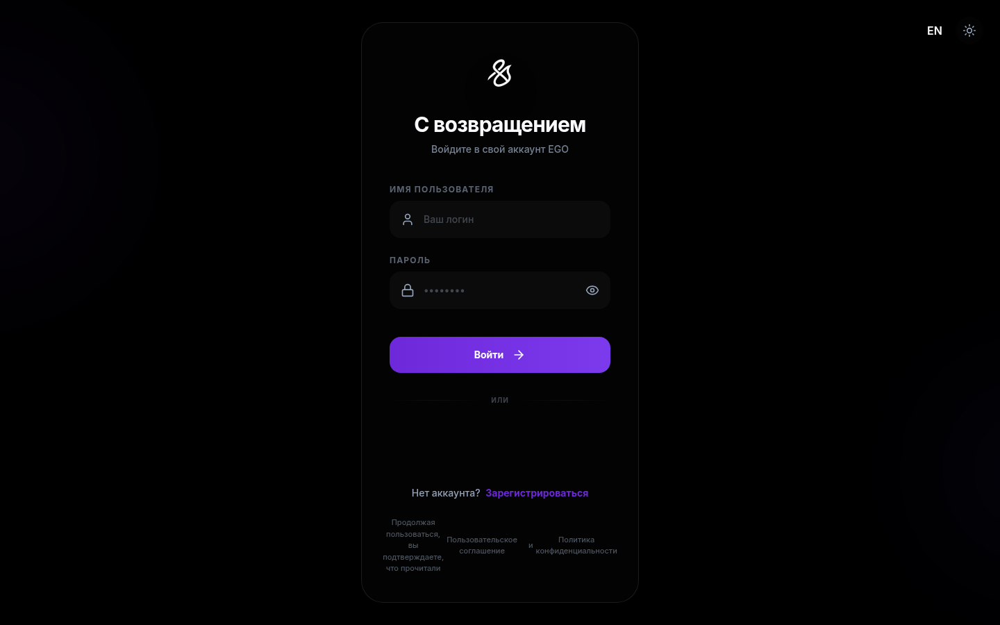

# EGO

Self-hosted AI agent platform for planning tasks, running tools, and recalling prior context.



## Tech Stack

Go · Python / FastAPI · SvelteKit / TypeScript · Docker · PostgreSQL / pgvector · MinIO

## Architecture Overview

- SvelteKit provides the chat workspace and displays streamed responses.
- The Go API orchestrates sessions, builds context, and dispatches tools.
- A Python reasoning service handles model calls and agent reasoning.
- Docker containers run code execution tools.
- PostgreSQL and pgvector support hybrid retrieval. MinIO holds uploaded files.

## Quick Start

Install Docker with Compose v2. Run these commands from the repository root.
Set a strong database password and JWT secret in the editor. Set `API_ENCRYPTION_KEY` to 64 hex characters and configure the model credentials you plan to use.

```sh
cp .env.example .env
${EDITOR:-vi} .env
docker compose up -d --build
```

Open [EGO](http://localhost:8080).

## 🚀 Key Features

### 🛡️ Secure Sandbox (ego_code_exec)

Code execution happens in an ephemeral **Docker Container**.

- **Isolation**: No access to the host filesystem.
- **Networking**: Restricted access (allowlist only).
- **Libraries**: Pre-installed data science stack (`numpy`, `pandas`, `sympy`).

### 💾 Holographic Memory (RAG++)

EGO remembers _everything_ using a **Hybrid Search** mechanism powered by **PostgreSQL (pgvector)**:

- **Semantic Search**: Finds concepts related by meaning.
- **Full-Text Search**: Finds specific keywords.
- **Temporal Ranking**: Prioritizes recent and relevant memories.
- **File Vectorization**: Uploaded PDFs and texts are chunked and embedded instantly.

### 🛠️ Integrated Tools

- **ego_search**: Real-time global web access (Google).
- **ego_tube**: Semantic analysis of YouTube video transcripts.
- **ego_knowledge**: Encyclopedic verification.
- **ego_calc**: Symbolic mathematics.

### 🎭 Adaptive Modes (Personas)

EGO switches its cognitive architecture based on the task:

- **⚡ Adaptive**: Low latency, balanced for general conversation.
- **🔬 Deeper**: Forces extended "Chain-of-Thought" reasoning for complex logic.
- **🌍 Research**: Optimized for deep web searching and report generation.
- **🤖 Agent**: Unlocks full sandbox access for autonomous coding tasks.

---

## 🛠️ Technical Architecture

| Component        | Technology                | Responsibility                                                                               |
| :--------------- | :------------------------ | :------------------------------------------------------------------------------------------- |
| **Orchestrator** | **Go (Golang) 1.25**      | High-performance WebSocket/SSE gateway, Auth, DB management, File processing. The "Spine".   |
| **AI Engine**    | **Python 3.12 + FastAPI** | LLM Inference (Gemini/OpenAI), Tool routing, Sandbox management, Thinking loop. The "Brain". |
| **Frontend**     | **SvelteKit 5**           | Reactive UI, Real-time streaming, Markdown rendering, State management (Runes).              |
| **Database**     | **PostgreSQL 16**         | Relational data (Users, Sessions) + **pgvector** (Embeddings).                               |
| **Storage**      | **MinIO**                 | Object storage for file attachments.                                                         |
| **Infra**        | **Docker Compose**        | Orchestrates the entire stack including the Sandbox network.                                 |

---

## 📸 Interface

The EGO UI is built for productivity:

- **Markdown & LaTeX**: Beautiful rendering of code and math.
- **Thinking Block**: Collapsible "Thought Process" to see how the AI arrived at an answer.
- **Sidebar**: Quick access to history, settings, and memory management.
- **Stats**: Real-time token usage and cost estimation.

---

---

<p align="center">
  Built by the EGO Team.
</p>
